<div align="center">


# tetoOS

**A Kasane Teto desktop shell for Hyprland and sxmwm, built on [Quickshell](https://quickshell.org).**

Sticker-sheet UI · colours read off your wallpaper · a phone that is your launcher,
control centre and settings · and a tiny Teto living in the corner of your screen.

[Русский](README.ru.md)

</div>

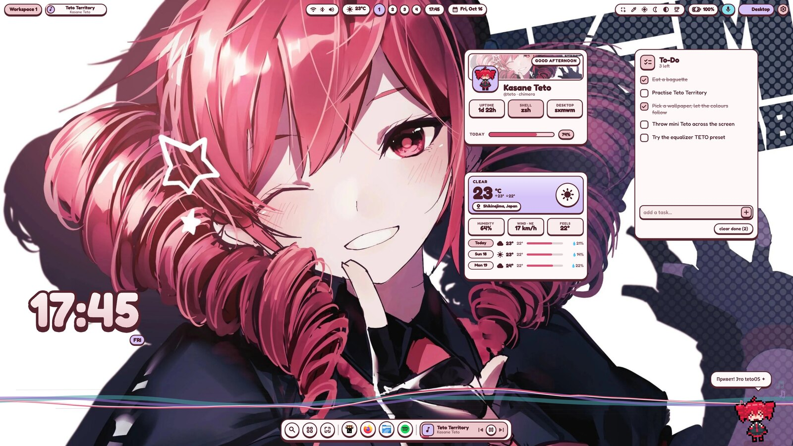

| Dark mode | Edit mode |
|---|---|
| 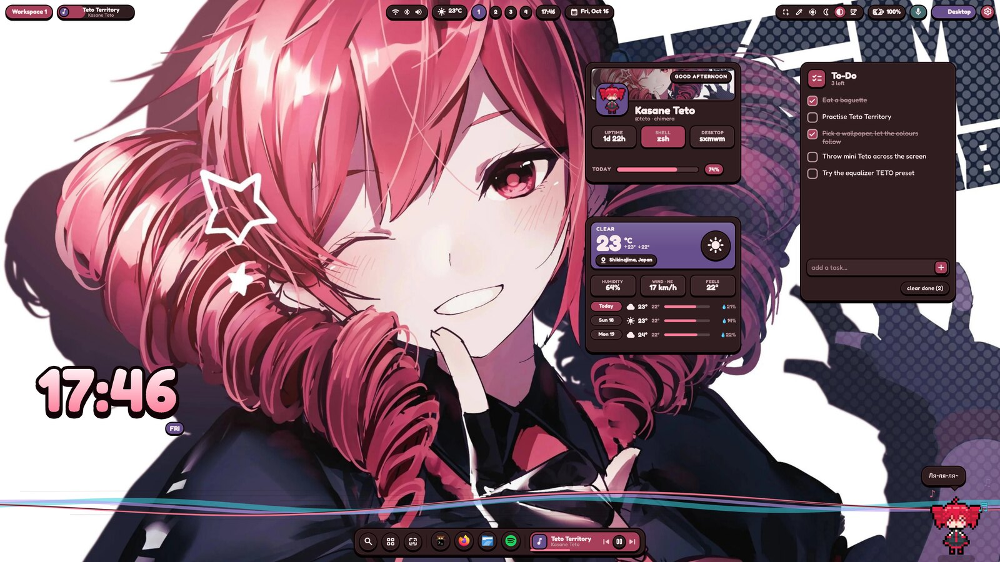 | 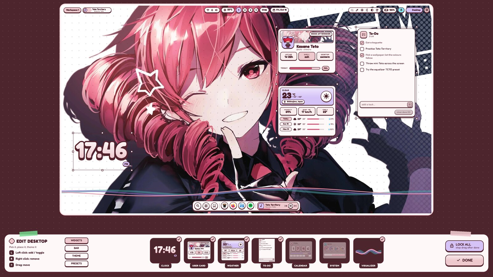 |

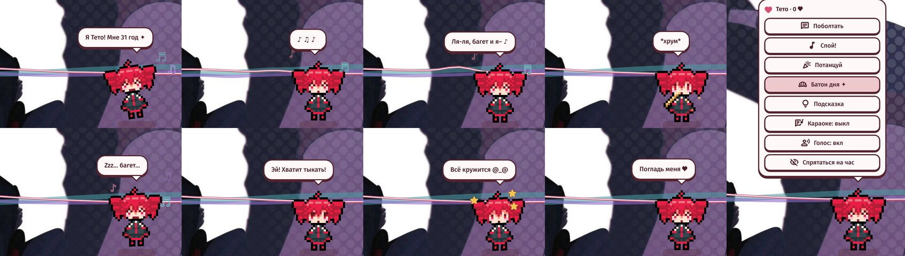

## What's inside

- **Colours from the wallpaper.** `scripts/palette.py` finds the hues that carry the picture
  and writes a light and a dark scheme in OKLCH. Change the wallpaper and the whole desk
  re-inks itself while the new picture opens in a circle from the middle. Or pin a preset:
  Teto, Miku, Rin, Luka, KAITO, GUMI, Neru.
- **Light, dark, auto.** Auto goes dark at night (20:00–07:00) or on a dark wallpaper.
- **Bar** of pills: workspaces, player, tray, Wi‑Fi/Bluetooth/volume, weather, clock, date,
  screenshot / colour picker / screen recorder / night light / dark mode / caffeine, battery,
  mic, focused window. Floating, straight or transparent; top or bottom.
- **Dock** with pinned apps, open windows and the player.
- **The phone.** Upright it is the launcher (apps, actions, `clip` for clipboard history,
  `=2+2` for a calculator) and the control centre (switches, sliders, notifications, power
  keys on its side button). Turned on its side it is the settings, the wallpaper picker and
  the sound page.
- **Sound:** a ten-band equalizer with presets (FLAT, BASS, VOCAL, AIR, LOUD, TETO), output
  picker and per-app volume. Wi‑Fi and Bluetooth lists.
- **Desktop widgets:** bubbly clock, to‑do, user card, weather with a three-day forecast,
  flip calendar, system monitor, and a music visualizer (cava). **Edit mode** shrinks the
  desk into a frame where you drag widgets, restyle the bar and swap themes.
- **Lock screen** (ext-session-lock + PAM), notifications, OSD, bar popups for battery,
  weather, calendar and player.
- **Lyrics** (lrclib.net) on the bar and, as karaoke, in Teto's speech bubble.

| Control centre | Launcher | Settings |
|---|---|---|
| 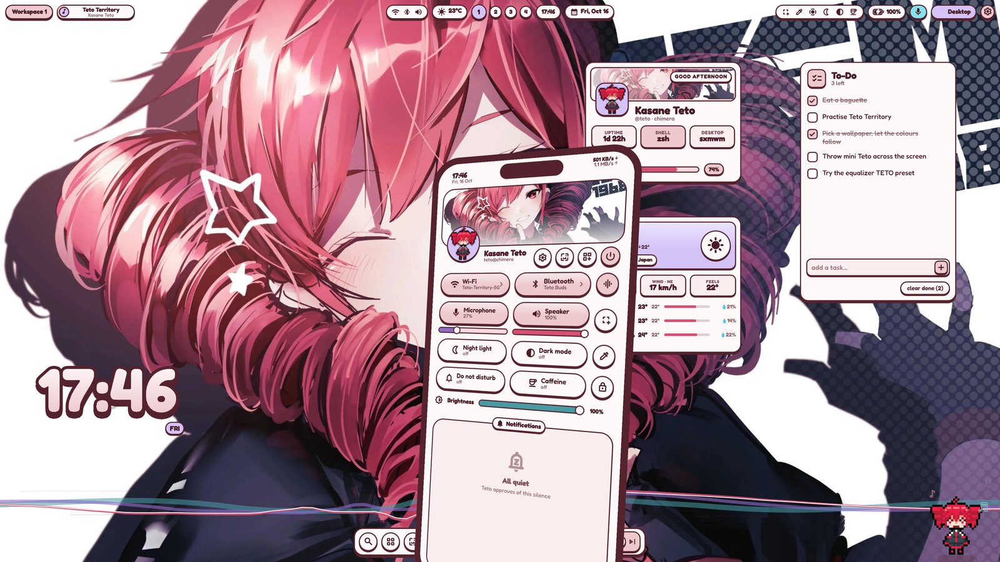 | 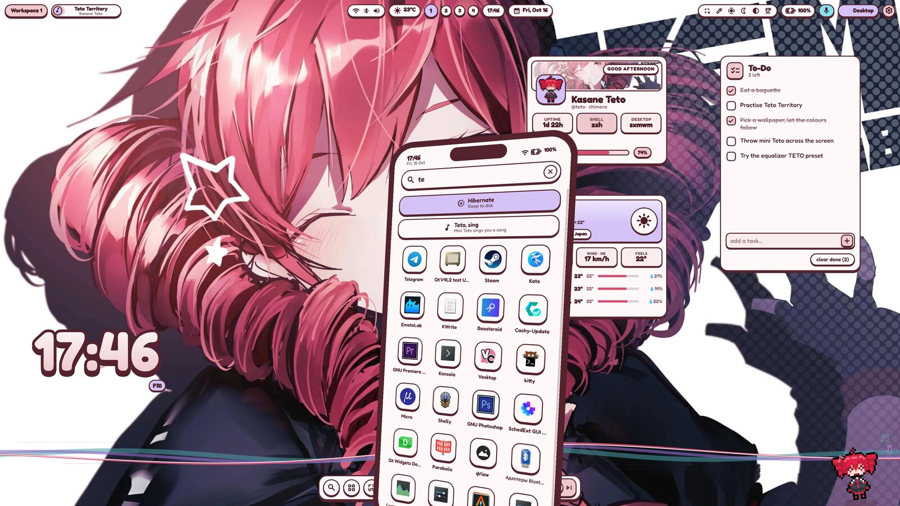 | 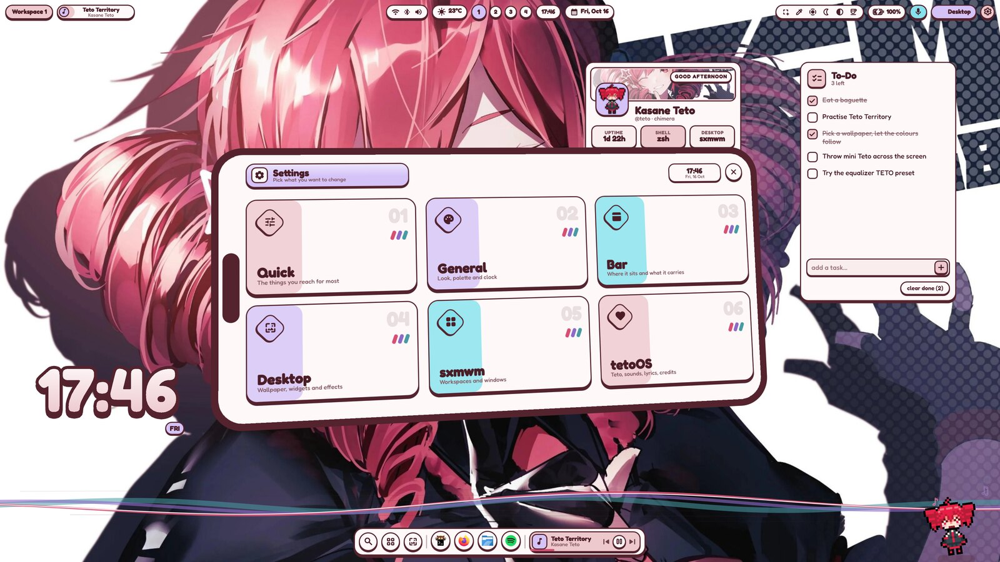 |

| Wallpapers | Sound | Wi‑Fi / Bluetooth |
|---|---|---|
| 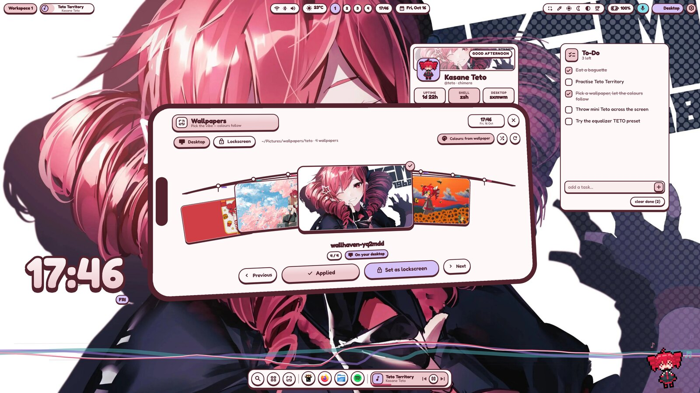 | 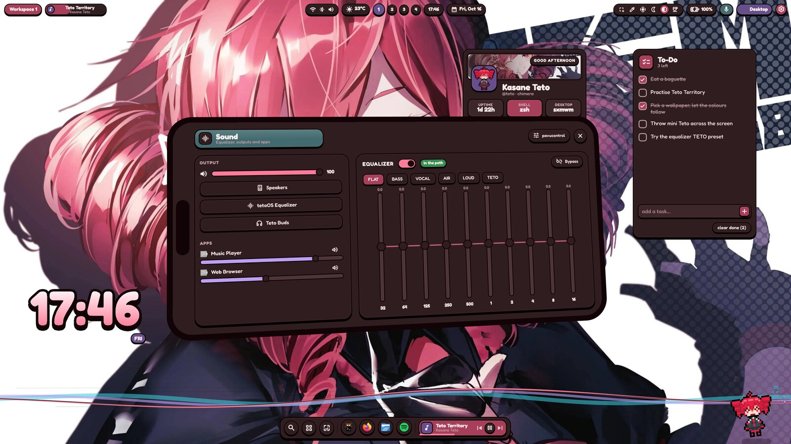 | 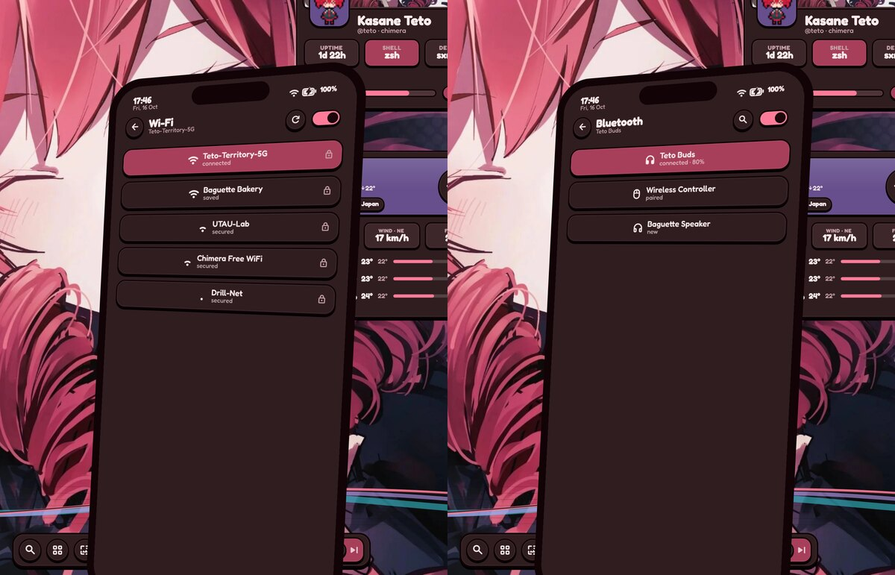 |

### Mini Teto

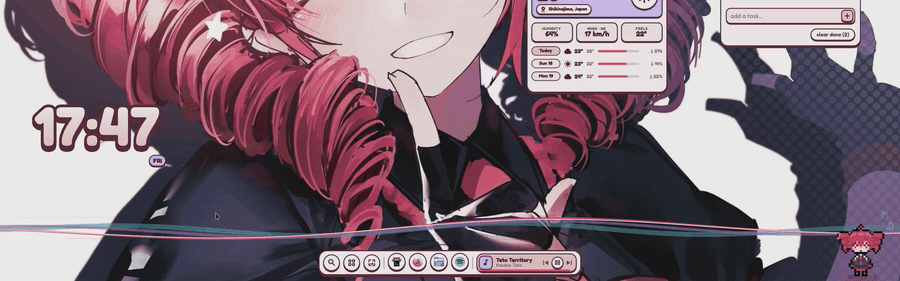

She lives in the bottom-right corner.

- **Click** — she answers. Five clicks in a row and she gets cross.
- **Right-click** — her menu: chat, sing, dance, bread of the day, tips, karaoke, voice, hide.
- **Scroll** over her — pet her.
- **Grab and throw** — she flies, bounces off the edges, gets dizzy after a hard landing and
  walks back to her corner.
- She types her lines with a little voice, greets you by the time of day, dances to music
  (and recognises her own songs), likes new wallpapers, worries about a low battery or a hot
  CPU, eats baguettes, and falls asleep when nothing happens.
- **Bread of the day:** one loaf a day, ★1–★5, with a fortune. Collect all ten.

She knows only what the shell already knows — the time, the music, the battery, the
wallpaper. She never reads your windows. Her lines are in Russian.

Put your own frames
(`idle.png`, `blink.png`, `talk.png`, `happy.png`, `sleep.png`, `shock.png`, `dizzy.png`,
`cheer.png`, `wink.png`, `eat.png`, `chew.png`, any size) into `~/.local/share/tetoos/teto/`
to give her a different look.

## Install

```bash
git clone https://github.com/saxxumm/tetoOS ~/.config/quickshell/tetoos
~/.config/quickshell/tetoos/install.sh
```

The installer asks before each step: system packages (pacman, then paru/yay for anything
in the AUR), fonts (Fredoka, Material Symbols), four Teto wallpapers from wallhaven.cc, the
PipeWire equalizer, and hooking the shell into your compositor. `./install.sh --help` lists
the switches; `--yes` takes every default.

Then stop any other shell (waybar, another Quickshell config, a notification daemon) and:

```bash
tetoos start
```

### Hyprland

- **0.55+ (`hyprland.lua`)**: the installer writes `~/.config/hypr/tetoos.lua` and adds
  `pcall(require, "tetoos")` to `hyprland.lua`.
- **Older (`hyprland.conf`)**: it writes `~/.config/hypr/tetoos.conf` and adds a `source =` line.

Only shell keys are bound; your window and workspace binds stay as they are.
`tetoos revert hyprland` takes it out again. Hyprland has no canvas overview, so the bar's
workspace pill and the dock's grid button open the launcher there, and a right-click on the
empty desktop opens the desktop menu.

### sxmwm

`tetoos use sxmwm` adds the autostart entries, the shell keys that are still free and the
canvas right-click to `~/.config/sxmwm/config.toml` (backed up first). A config set up for
angelOS is switched over binding by binding.

## Keys

| Key | |
|---|---|
| `Super+D` | launcher |
| `Super+N` | control centre |
| `Super+/` | settings |
| `Super+Shift+B` | wallpapers |
| `Super+Shift+V` | clipboard |
| `Super+Shift+D` | edit the desktop |
| `Super+Shift+.` | light / dark |
| `Super+Shift+E` | power menu |
| `Super+Alt+Y` | Teto karaoke |
| `Super+L` | lock |
| volume / brightness / media keys | with an on-screen display |

## Command line

```
tetoos start | stop | restart | status
tetoos ipc <function> [args]      # launcher, control, settings, wallpapers, sound, wifi,
                                  # bluetooth, clipboard, power, edit, lock, record,
                                  # setWallpaper <path>, preset <name>, mode <light|dark|auto>,
                                  # tetoSay <text>, tetoSing, tetoDance, tetoEat, bread, …
tetoos palette <image>            # recolour from a picture
tetoos use | revert [hyprland|sxmwm]
```

Settings live in `~/.local/state/tetoos/config.json` (or `$TETOOS_STATE`).

## Layout

| | |
|---|---|
| `theme/` | colours, type, sizes — colours come from `colors.json` |
| `ui/` | the primitives: `Sticker`, `Tap`, `Slide`, `Tag`, `StrokeText`, … |
| `services/` | state: compositor (Hyprland / sxmwm), audio, equalizer, network, Bluetooth, media, lyrics, weather, to‑do, clipboard, notifications, recorder, Teto, config, IPC |
| `bar/` `dock/` `desktop/` `phone/` `popups/` `lock/` `edit/` `osd/` `notifications/` | what is drawn |
| `teto/` | mini Teto and her lines |
| `scripts/` | palette, sounds (synthesised with numpy), lyrics, sprites, compositor hooks |
| `hypr/` `pipewire/` | Hyprland config templates, the equalizer chain |

## Trying it without logging out

Inside a nested compositor:

```bash
TETOOS_DEMO=1 TETOOS_NESTED=1 TETOOS_STATE=/tmp/tetoos-demo qs -p ~/.config/quickshell/tetoos
```

`TETOOS_DEMO=1` swaps everything personal (name, networks, devices, music, place) for
stand-ins — that is how the screenshots here were taken. `TETOOS_NESTED=1` keeps a test
instance off the notification bus, the speakers and the real equalizer.

## Credits

- Kasane Teto © TwinDrill. This is an unofficial fan project.
- Pixel Teto: drawn by saxxumm.
- Fredoka (SIL OFL) and Material Symbols (Apache 2.0) are downloaded by the installer, not bundled.
- Wallpapers are not bundled; the installer can fetch four from wallhaven.cc, where their
  artists posted them.
- The audio, network, media and compositor services started life in the author's shell for
  sxmwm, a canvas fork of [driftwm](https://github.com/malbiruk/driftwm).

## License

MIT — see [LICENSE](LICENSE). The character belongs to her owners; the code is yours to use.
